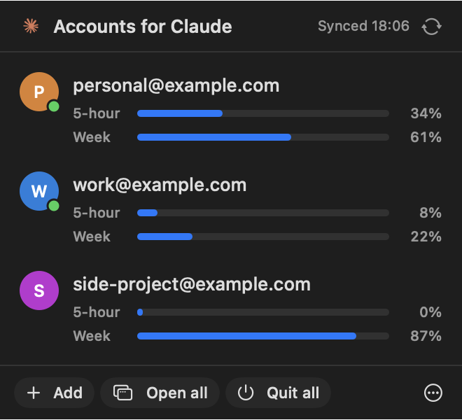

# Accounts for Claude

A menu bar app for people who use several Claude accounts on one Mac. See every account at a glance, with its live 5-hour and weekly usage, and open, restart or add accounts with one click.



macOS 14.4+ · Apple silicon and Intel · Swift / SwiftUI · MIT · **unofficial, not affiliated with or endorsed by Anthropic**

## What it does

- **Every account in one place.** Each Claude Desktop profile is a card with a green dot when its window is open. Click a card to bring that window forward, or to open it.
- **Live usage for all of them.** The 5-hour and weekly bars come straight from claude.ai, the same numbers as Claude's own usage panel, even for accounts whose window is closed. Hover over a bar to see when that limit resets.
- **One-click actions.** Add an account, open all of them, quit all of them, restart or remove one (right-click a card), and sync Claude Code sessions between accounts.
- **Stays out of the way.** It lives only in the menu bar and fetches usage only while the popover is open.

## Requirements

- macOS 14.4 or later
- [Claude Desktop](https://claude.ai/download) in `/Applications`
- [**claude-multi**](https://github.com/EminBudak/claude-multi-account) by Emin Budak. This app is a front end for it: `claude-multi` creates the per-account profiles, launches them and syncs the session lists. Without it the app shows a short setup notice.

## Install

1. Install `claude-multi` and set up your accounts (see its [Quick start](https://github.com/EminBudak/claude-multi-account#quick-start)):
   ```bash
   git clone https://github.com/EminBudak/claude-multi-account.git
   cd claude-multi-account && ./install.sh
   claude-multi setup you@example.com you@work.example.com
   ```
2. Download **AccountsForClaude-x.y.z.dmg** from [Releases](https://github.com/prjwrld/accounts-for-claude/releases), open it, and drag **Accounts for Claude** into Applications.
3. Open it. Look for the Claude logo in the menu bar. To start it automatically, use ⋯ → **Open at Login**.

The app is signed with a Developer ID and notarized by Apple, so it opens without Gatekeeper warnings.

## How live usage works, and what it can access

Claude Desktop saves a usage sample to disk only now and then, often hours apart, so reading that file shows old numbers. To show what Claude's own panel shows, the app asks claude.ai directly, signed in as each profile:

1. It reads the **"Claude Safe Storage"** password from your Keychain. The first time, macOS asks whether *Accounts for Claude* may use it: choose **Always Allow**. Every profile is the same Claude app, so this one key covers all of them.
2. It decrypts that profile's claude.ai sign-in cookie (`sessionKey`) and its last-used organisation, in memory.
3. It requests `https://claude.ai/api/organizations/<org>/usage`, the endpoint Claude's usage panel uses.

The sign-in cookie and the key are **never written to disk, logged, or sent anywhere except claude.ai**. Requests go out only while the popover is open: once when you open it, then every 30 seconds. If anything fails (you declined the Keychain prompt, the sign-in expired, claude.ai changed), the card falls back to the last number Claude saved and says how old it is.

That endpoint is not a documented public API, so a Claude update could change it; when it does, the app falls back to saved numbers instead of breaking. All of the code that touches your sign-in is in [`Sources/LiveUsage.swift`](Sources/LiveUsage.swift), about 200 lines, so you can read it before you trust it.

The menu bar icon is Claude's own logo, loaded at runtime from your installed Claude.app. This repository doesn't include it.

## Build from source

```bash
git clone https://github.com/prjwrld/accounts-for-claude.git
cd accounts-for-claude
scripts/build.sh install      # builds, copies to /Applications and opens it
```

Needs Xcode (or its command line tools) for `swiftc`. `build.sh` signs with the first *Developer ID Application* certificate in your keychain and falls back to ad-hoc signing, which is fine on your own Mac. Every new ad-hoc build is a different app as far as the Keychain is concerned, so expect the Keychain prompt again after rebuilding.

Headless checks, handy when changing things:

```bash
APP="build/Accounts for Claude.app/Contents/MacOS/AccountsForClaude"
"$APP" --print-status              # accounts, running state, saved usage
"$APP" --live --print-status       # same, with live usage (percentages only, never the cookie)
"$APP" --snapshot popover.png --demo   # render the popover with example accounts
```

`scripts/make-icon.swift` redraws the app icon (`Resources/AppIcon.icns`).

## Releasing

```bash
# once: store notarization credentials in your keychain (you type the app-specific password)
xcrun notarytool store-credentials <profile> --apple-id <you@example.com> --team-id <TEAMID>

# each release: bump VERSION, then
NOTARY_PROFILE=<profile> scripts/release.sh
```

This produces `dist/AccountsForClaude-<version>.dmg`, signed, notarized and stapled, plus a `.sha256` file. Attach both to a GitHub release.

## Credits

- [claude-multi-account](https://github.com/EminBudak/claude-multi-account) by Emin Budak (MIT) does the real work: profiles, launchers and session sync. This app is only a menu bar front end for it.
- "Claude" is a trademark of Anthropic, PBC. This project is independent and unofficial.

## License

[MIT](LICENSE)
